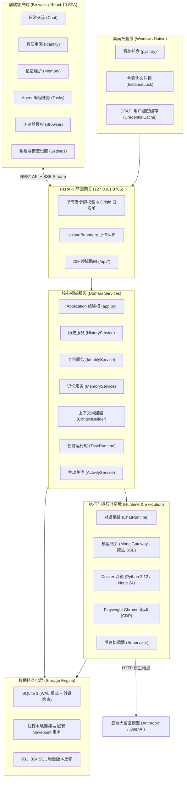

# LingNexus 系统架构设计与代码审查报告 (System Architecture & Review)

> 报告生成时间：2026-10-10  
> 审查基线版本：0.1.1 (Windows 首版)  
> 审查范围：后端核心 (`src/lingnexus/*`)、前端交互 (`frontend/src/*`)、测试套件 (`tests/*`)、数据迁移 (`storage/migrations/*`) 及系统构建脚本

---

## 1. 系统概览与核心定位 (System Overview & Philosophy)

LingNexus（代号「灵」）是由所有者完全掌握发展方向的**长期个人 AI 系统 (Owner-controlled long-lived personal AI system)**。其首发版本针对 Windows 桌面环境，通过本机后台常驻进程与现代化中文图形界面，对云端模型调度、人机交流、连续发展记忆、可演化自我状态、Agent 多步任务以及主动环境关注进行端到端统一管理。

### 核心设计哲学与设计原则
1. **真实性与不可篡改历史 (Immutable Grounded History)**:
   - 原始经历以多版本形式物理保存在历史层，只追加不重写。任何派生记忆、知识或人设变化都必须携带精确的原始证据来源引用（`SourceRef: id + revision`）。
   - 虚构场景与未经核实的信息被严格隔离，绝不能当作现实经历沉淀为人格依据（[`src/lingnexus/identity/policy.py:12-19`](file:///C:/Users/34375/.gemini/antigravity/worktrees/a9a6a57f-1b6b-4d1d-a130-3b0f0fd595d6/subagent-Codebase-Mapper-gsd-researcher-c2769f4b/src/lingnexus/identity/policy.py#L12-L19)）。
2. **人设透明化与全链路可审计 (Transparent & Evolvable Persona)**:
   - 人格不是不可修改的静态提示词角色卡，也不是不可预测的黑盒。系统将其解构成三层体系：**系统指令清单 (System Instructions) / 当前身份各维度条目 (Current Identity Entries) / 待审批候选提案 (Pending Proposals)**。
   - 只有预定义的低风险结构化沟通习惯允许自动应用，核心身份、价值观与重大能力变化必须由所有者显式确认（[`src/lingnexus/identity/policy.py:49-50`](file:///C:/Users/34375/.gemini/antigravity/worktrees/a9a6a57f-1b6b-4d1d-a130-3b0f0fd595d6/subagent-Codebase-Mapper-gsd-researcher-c2769f4b/src/lingnexus/identity/policy.py#L49-L50)）。
3. **级联失效与反向追溯 (Cascading Invalidation)**:
   - 当历史消息被修正、对话轮次被删除或分支被隐藏时，系统自动触发事件发布-订阅机制，使由该条目派生出的情节记忆、语义知识、目标以及自我状态候选精准标记失效或回退，彻底防止过时或虚假信息毒化后续上下文（[`src/lingnexus/app.py:33-37`](file:///C:/Users/34375/.gemini/antigravity/worktrees/a9a6a57f-1b6b-4d1d-a130-3b0f0fd595d6/subagent-Codebase-Mapper-gsd-researcher-c2769f4b/src/lingnexus/app.py#L33-L37)）。
4. **零供应商 SDK 依赖与凭据绝不出境 (Zero SDK Dependency & Secret Guarding)**:
   - 不依赖任何三方 LLM SDK（如 `openai`, `anthropic` 包），完全基于原生 `httpx` + 严格 SSE 事件流解析器实现，避免依赖膨胀与破坏性升级。
   - 所有者模型密钥通过 Windows 原生 DPAPI 加密存储在用户本地缓存，前端永远不反查密钥明文；运行时具备 `SecretGuard` 双向密钥泄漏守卫，严防模型回显凭据进入持久化存储（[`src/lingnexus/runtime/service.py:266-285`](file:///C:/Users/34375/.gemini/antigravity/worktrees/a9a6a57f-1b6b-4d1d-a130-3b0f0fd595d6/subagent-Codebase-Mapper-gsd-researcher-c2769f4b/src/lingnexus/runtime/service.py#L266-L285)）。
5. **本地优先与前台优先原则 (Local-First & Foreground Priority)**:
   - 单体单进程架构，单实例互斥锁与托盘常驻。后台学习与主动关注任务在用户进行前台交互（对话生成或任务运行）时主动退让（`foreground_busy`），绝不抢占前台体验。



---

## 2. 系统分层与组件全景 (Component Map)

系统采用典型的**模块化单体架构 (Modular Monolith)**，高内聚低耦合，`src/lingnexus/app.py` 扮演唯一的组合根 (Composition Root)。

### 2.1 模块职责详细划分

| 模块名称 | 物理路径 | 核心类/组件 | 职责描述与关键细节 |
| :--- | :--- | :--- | :--- |
| **组装根 (App Root)** | [`src/lingnexus/app.py`](file:///C:/Users/34375/.gemini/antigravity/worktrees/a9a6a57f-1b6b-4d1d-a130-3b0f0fd595d6/subagent-Codebase-Mapper-gsd-researcher-c2769f4b/src/lingnexus/app.py#L27) | `Application` | 实例化所有公共领域服务，集中注册事件反向失效监听器，持有全局连接生命周期 |
| **API 网关** | [`src/lingnexus/api/`](file:///C:/Users/34375/.gemini/antigravity/worktrees/a9a6a57f-1b6b-4d1d-a130-3b0f0fd595d6/subagent-Codebase-Mapper-gsd-researcher-c2769f4b/src/lingnexus/api/app.py#L65) | `create_app`, `security.py`, `upload_boundary.py` | FastAPI 应用装配；双重路由映射（根路径与 `/api` 兼容前缀）；静态页面挂载；异常统一转换与脱敏 |
| **对话会话 (Conversations)** | [`src/lingnexus/conversations/`](file:///C:/Users/34375/.gemini/antigravity/worktrees/a9a6a57f-1b6b-4d1d-a130-3b0f0fd595d6/subagent-Codebase-Mapper-gsd-researcher-c2769f4b/src/lingnexus/conversations/service.py#L11) | `Conversations`, `Segments` | 单个体持续交流管理；树状分支消息图（`conversation_messages` 自引用外键）；轮次级拓扑删除（`delete_turns`） |
| **对话运行时 (Runtime)** | [`src/lingnexus/runtime/`](file:///C:/Users/34375/.gemini/antigravity/worktrees/a9a6a57f-1b6b-4d1d-a130-3b0f0fd595d6/subagent-Codebase-Mapper-gsd-researcher-c2769f4b/src/lingnexus/runtime/service.py#L57) | `ChatRuntime`, `ChatFailover`, `RunStore`, `SecretGuard` | 幂等请求提交 (`submit`)；双尝试自动故障转移；SSE 事件持久化与游标断点续传；流式推理与思考过程捕获 |
| **上下文组装 (Context)** | [`src/lingnexus/context/`](file:///C:/Users/34375/.gemini/antigravity/worktrees/a9a6a57f-1b6b-4d1d-a130-3b0f0fd595d6/subagent-Codebase-Mapper-gsd-researcher-c2769f4b/src/lingnexus/context/builder.py#L46) | `ContextBuilder`, `recall.py`, `BudgetPolicy` | 严密预算策略分配；动态截取最近连续对话历史；基于中英文多词/Bi-gram的字面回忆候选检索；格式化上下文清单 (Manifest) |
| **模型网关 (Models)** | [`src/lingnexus/models/`](file:///C:/Users/34375/.gemini/antigravity/worktrees/a9a6a57f-1b6b-4d1d-a130-3b0f0fd595d6/subagent-Codebase-Mapper-gsd-researcher-c2769f4b/src/lingnexus/models/gateway.py#L29) | `ModelGateway`, `_parsers.py`, `_sse.py` | 零第三方 SDK；纯 HTTPX 统一调度 Anthropic Messages、OpenAI Chat Completions、OpenAI Responses 原生规范 |
| **历史底稿 (History)** | [`src/lingnexus/history/`](file:///C:/Users/34375/.gemini/antigravity/worktrees/a9a6a57f-1b6b-4d1d-a130-3b0f0fd595d6/subagent-Codebase-Mapper-gsd-researcher-c2769f4b/src/lingnexus/history/service.py#L10) | `HistoryService` | 原始输入条目与多修订版本维护 (`sources`, `source_revisions`)；经历修正 (`correct`) 与可见性分支控制 (`set_visible`)；失效发布通知 |
| **长期记忆 (Memory)** | [`src/lingnexus/memory/`](file:///C:/Users/34375/.gemini/antigravity/worktrees/a9a6a57f-1b6b-4d1d-a130-3b0f0fd595d6/subagent-Codebase-Mapper-gsd-researcher-c2769f4b/src/lingnexus/memory/service.py#L7) | `MemoryService`, `Episodes`, `Knowledge`, `MemoryMaintenance` | 情节记忆 (事件卡片) 与陈述性语义知识库；所有者手动更正与归档审计；模型执行期间记忆版本指纹检验 (`snapshot_marker`) |
| **身份与自我 (Identity)** | [`src/lingnexus/identity/`](file:///C:/Users/34375/.gemini/antigravity/worktrees/a9a6a57f-1b6b-4d1d-a130-3b0f0fd595d6/subagent-Codebase-Mapper-gsd-researcher-c2769f4b/src/lingnexus/identity/service.py#L11) | `IdentityService`, `Changes`, `Revisions`, `policy.py` | 长期人格状态快照 (`self_revisions`)；提议提案审批状态机；条目来源反向追踪 (`self_entry_origins`)；安全习惯与高风险特征判定 |
| **后台学习 (Learning)** | [`src/lingnexus/learning/`](file:///C:/Users/34375/.gemini/antigravity/worktrees/a9a6a57f-1b6b-4d1d-a130-3b0f0fd595d6/subagent-Codebase-Mapper-gsd-researcher-c2769f4b/src/lingnexus/learning/worker.py#L46) | `ConsolidationWorker`, `Jobs`, `prompt.py` | 异步经历提炼工作机；自动抽取事件、知识点与身份演进建议；显式给未验证事实添加前缀保护 |
| **后台协调器 (Background)** | [`src/lingnexus/background/`](file:///C:/Users/34375/.gemini/antigravity/worktrees/a9a6a57f-1b6b-4d1d-a130-3b0f0fd595d6/subagent-Codebase-Mapper-gsd-researcher-c2769f4b/src/lingnexus/background/supervisor.py#L11) | `Supervisor` | 单一后台协程协调器（默认 20s 周期）；协调自动备份、主动关注和记忆整理；检测 `foreground_busy` 并主动避让 |
| **Agent 任务 (Tasks)** | [`src/lingnexus/tasks/`](file:///C:/Users/34375/.gemini/antigravity/worktrees/a9a6a57f-1b6b-4d1d-a130-3b0f0fd595d6/subagent-Codebase-Mapper-gsd-researcher-c2769f4b/src/lingnexus/tasks/service.py#L35) | `TaskRuntime`, `execution.py`, `workspace.py` | 多步 Agent 自主编程；支持 Docker (Python 3.12 / Node 24) 隔离执行；工作区文件快照比对 (`changes`) 与审批写回 (`apply`) |
| **主动关注 (Activities)** | [`src/lingnexus/activities/`](file:///C:/Users/34375/.gemini/antigravity/worktrees/a9a6a57f-1b6b-4d1d-a130-3b0f0fd595d6/subagent-Codebase-Mapper-gsd-researcher-c2769f4b/src/lingnexus/activities/service.py#L52) | `ActivityService`, `attention.py`, `investigation.py` | 关注事项周期轮询（文件变更、网页快照、RSS）；基于主模型的自主评估与行动建议提议 |
| **浏览器自动化 (Browser)** | [`src/lingnexus/browser/`](file:///C:/Users/34375/.gemini/antigravity/worktrees/a9a6a57f-1b6b-4d1d-a130-3b0f0fd595d6/subagent-Codebase-Mapper-gsd-researcher-c2769f4b/src/lingnexus/browser/service.py#L32) | `BrowserService`, `driver.py`, `policy.py` | Playwright CDP 驱动本地 Chrome；域名白名单授权；DOM 结构读取与表单填充；敏感点击/提交需所有者显式二次审批 |
| **数据维护 (Maintenance)** | [`src/lingnexus/maintenance/`](file:///C:/Users/34375/.gemini/antigravity/worktrees/a9a6a57f-1b6b-4d1d-a130-3b0f0fd595d6/subagent-Codebase-Mapper-gsd-researcher-c2769f4b/src/lingnexus/maintenance/service.py#L25) | `MaintenanceService`, `automatic.py`, `restore.py` | 数据库、附件、任务资产完整打包与 SHA256 校验；自动循环保留 14 份备份；独占重启式安全还原 |
| **系统配置 (Configuration)** | [`src/lingnexus/configuration/`](file:///C:/Users/34375/.gemini/antigravity/worktrees/a9a6a57f-1b6b-4d1d-a130-3b0f0fd595d6/subagent-Codebase-Mapper-gsd-researcher-c2769f4b/src/lingnexus/configuration/profiles.py#L22) | `Profiles`, `CredentialCache`, `OwnerInstructions` | 多模型渠道配置与单价计算；DPAPI 密钥本地加密与内存释放；每个体独立可编辑系统指令清单 |
| **持久层 (Storage)** | [`src/lingnexus/storage/`](file:///C:/Users/34375/.gemini/antigravity/worktrees/a9a6a57f-1b6b-4d1d-a130-3b0f0fd595d6/subagent-Codebase-Mapper-gsd-researcher-c2769f4b/src/lingnexus/storage/db.py#L10) | `Database` | SQLite 基础设施；开启 WAL 模式、外键约束、10s busy timeout；支持线程本地嵌套 Savepoint 事务；事务后回调机制 |
| **桌面集成 (Desktop)** | [`src/lingnexus/desktop/`](file:///C:/Users/34375/.gemini/antigravity/worktrees/a9a6a57f-1b6b-4d1d-a130-3b0f0fd595d6/subagent-Codebase-Mapper-gsd-researcher-c2769f4b/src/lingnexus/desktop/launcher.py#L36) | `DesktopLauncher`, `WindowsTray`, `InstanceLock` | Windows 托盘集成；单进程文件锁（多开时唤起已有浏览器窗口）；自启动注册管理；启动前还原钩子 |

### 2.2 前端架构 (React 19 SPA)

前端基于 React 19 + TypeScript + Vite 8 构建，UI 风格克制扁平，无重型组件库，采用模块化纯 CSS。
- **架构模块划分**：共包含 14 个独立 Feature 模块（`frontend/src/features/*`），包括 `chat`, `identity`, `memory`, `tasks`, `activities`, `browser`, `background`, `content`, `development`, `skills`, `settings`, `overview`, `onboarding`, `sources`。
- **状态与流式响应**：
  - 会话管理通过 `useConversations` 与本地 `sessionStorage` 维持状态与刷新恢复。
  - 流式响应采用原生 `EventSource` 与分块 `fetch`，在 `ChatStream.test.ts` 中针对断线重连、游标递增、重放幂等、思考内容隔离进行完整的测试防护。
  - 交互优化：气泡贴合文本尺寸 (`fit-content`)，消息操作悬停显示，对话区撑满视口，对话列表与导航独立纵向滚动。

---

## 3. 端到端核心数据流 (End-to-End Data Flows)

### 3.1 核心数据流 A：日常对话与流式推理全生命周期

```
用户在前端输入消息并点击发送
  │
  ▼
[API: POST /conversations/{id}/chat]
  │  (Token 鉴权、Origin 校验、请求指纹校验)
  ▼
[ChatRuntime.submit]
  │  (检查是否有正在进行的 run；幂等去重；绑定当前交流分支)
  ▼
[runtime.payload.build_payload]
  ├─ 1. 获取模型上下文与最大输出限制
  ├─ 2. 提取系统指令 (OwnerInstructions) + 当前自我状态 (IdentitySnapshot)
  ├─ 3. 执行候选回忆字面检索 (context.recall.candidates -> episodes & knowledge)
  │     └─ 抓取相关事件与知识，附加最多3条原始经历片段 (original_excerpt)
  ├─ 4. 动态计算输入预算，保留最近连续的消息链，组装附件 Plans
  └─ 5. 按模型 APIFamily (Anthropic / Responses / Completions) 格式化 Native Payload
  │
  ▼
[ChatRuntime._execute -> ModelGateway.stream]
  │  (通过原生 httpx 发起异步 SSE 请求；实例化 SecretGuard 防止密钥泄露)
  ├─ 接收 text_delta -> 追加到 RunStore 队列 -> SSE 推送前端展示
  ├─ 接收 thinking_delta -> 追加到 thinking 队列 -> 前端可折叠显示思考过程
  ├─ 若遇主模型连接失败/超时/HTTP错误 -> ChatFailover 触发一次自动重试，平滑切至备用模型
  └─ 接收 complete 事件 -> 核验 finish_reason
  │
  ▼
[ChatRuntime._complete 事务持久化]
  ├─ 1. 在 conversations 中追加 assistant 节点
  ├─ 2. 在 history.sources 中持久化助手回复经历 (SourceRef)
  ├─ 3. 将 run 状态置为 completed，记录最终 usage 与 token 计费
  └─ 4. 向 jobs 队列推入一条 consolidate 记忆整理任务
```

### 3.2 核心数据流 B：轮次级删除与级联失效链路

当所有者对某轮对话进行删除时，系统执行深度安全清理与依赖级联作废：

```
所有者点击「删除这一轮」/「批量删除」
  │
  ▼
[Conversations.delete_turns(anchors)]
  ├─ 1. 验证锚点：必须是当前路径上的用户消息 (非用户消息或脱离路径则拒绝)
  ├─ 2. 识别整轮：一条用户消息 + 其后伴随的灵回复
  ├─ 3. 重新接线：将幸存消息按顺序更新 parent_id，重新链接 head_id
  ├─ 4. 级联标记失效：
  │      调用 history.set_visible(node["source"], False)
  │      │
  │      ▼ 触发发布订阅广播 (HistoryService._on_correct)
  │      ├─ IdentityService.invalidate: 作废基于该经历产生的人格变更提案
  │      ├─ MemoryService.invalidate: 将相关 episodes.status 置为 'invalidated'
  │      ├─ Knowledge.invalidate: 将相关 knowledge.status 置为 'invalidated'
  │      ├─ DevelopmentService.invalidate: 作废长期目标衍生依据
  │      └─ SkillsService.invalidate: 停用相关技能依据
  │
  ├─ 5. 拓扑级联物理删除：
  │      自引用外键树按深度从深到浅删除 conversation_messages 节点及其下方废弃分支
  │      解除 chat_runs.user_message_id 外键引用并清理附件引用
  └─ 6. 事务整体提交 (WAL 原子提交)
```

### 3.3 核心数据流 C：后台学习与自我演进链路

```
[Supervisor._loop (每 20s 一次)]
  │
  ├─ 检查前台状态 (foreground_busy: 聊天运行中或 Agent 任务运行中则主动让出)
  ├─ 执行 automatic_backups.tick()
  ├─ 执行 activities.tick() (检查提醒与环境变动)
  │
  ▼
[ConsolidationWorker.run_once]
  │  (从 jobs 表原子领用一条 queued 状态的 consolidate 任务)
  ▼
[校验来源状态]
  │  (核验 source 是否仍然有效，未被纠正或删除，若已失效则标记 stale)
  ▼
[组装提炼 Prompt -> ModelGateway 推理]
  │  (调用主模型抽取事件概要、语义知识与潜在自我状态变化)
  ▼
[ConsolidationWorker._persist 事务写入]
  ├─ 1. 再次校验 source 与 memory_markers (防止思考期间前台已修改)
  ├─ 2. 显式添加未验证前缀 (如 "用户报告（未经独立核实）：")
  ├─ 3. 存储事件 (Episodes) 与知识条目 (Knowledge)
  └─ 4. 处理自我状态变化 (Changes):
         ├─ 若属于 SAFE_HABITS (预定义的低风险结构化习惯) -> 自动应用并升级自我版本
         └─ 若属于 PROTECTED_KINDS (身份/价值观/重大特征) -> 生成 awaiting_owner 提案，等待所有者审阅
```

---

## 4. 技术栈全貌与基础设施 (Tech Stack Inventory)

关于技术依赖库与具体版本的详细清单，请参见配套文档 [`.gsd/STACK.md`](file:///C:/Users/34375/.gemini/antigravity/worktrees/a9a6a57f-1b6b-4d1d-a130-3b0f0fd595d6/subagent-Codebase-Mapper-gsd-researcher-c2769f4b/.gsd/STACK.md)。此处重点说明核心框架决策：

- **Python 运行时**：Python 3.12（锁定范围 `>=3.12,<3.13`），通过 `uv.lock` 进行绝对确定的多层哈希锁定。
- **存储驱动**：原生 `sqlite3`（无 SQLAlchemy 等重型 ORM），完全采用领域原生手写 SQL 与 `001_history.sql` ~ `024_segments.sql` 增量迁移脚本，杜绝 ORM 隐藏的 N+1 查询与事务黑盒。
- **Web 框架**：FastAPI + Uvicorn + Starlette，负责本地 IPC 通信与 SSE 长连接流式推送。
- **前端工具链**：Node 24 + Vite 8 + React 19 + TypeScript 7 + Vitest 5，极致精简打包，构建产物直接打入可执行文件或通过 Python 托管。
- **隔离与沙箱**：Docker（通过标准 CLI 隔离执行容器，使用官方精简镜像 `python:3.12-slim` 与 `node:24-bookworm-slim`）；Playwright（驱动本地 Google Chrome 进行受控网页交互）。

---

## 5. 代码质量审查、技术债与风险评估 (Code Quality & Technical Debt)

### 5.1 代码质量优势与工程亮点

1. **零技术遗留标记 (Zero TODOs/FIXMEs)**:
   - 全仓库代码搜索 `TODO`, `FIXME`, `HACK`, `XXX`（不论大小写），**匹配结果为 0**。代码库不存在任何半途而废的临时占位或未实现伪逻辑。
2. **测试驱动与极高测试密度**:
   - 后端 Pytest 测试套件包含 **1329** 项完整单元测试与集成测试，覆盖事务原子性、级联失效、密钥防护、模型故障转移、Docker 权限边界与 Windows 路径逃逸防护。
   - 前端 Vitest 测试套件包含 **145** 项测试，100% 通过（24 个测试套件包含聊天状态、流式解析、单/多轮删除、人设审阅等）。
3. **静态类型与 Lint 规范极度严苛**:
   - `ruff check src tests scripts`：全部通过，0 警告。
   - `pyright` 标准类型检查模式：0 errors, 0 warnings, 0 informations。
   - 前端 `tsc --noEmit`：0 errors，类型完全收敛。
4. **防御性设计 (Defensive Engineering)**:
   - 敏感信息阻断：`SecretGuard` 在生成阶段与学习阶段双重阻断 API 密钥回显。
   - 路径逃逸防御：`WorkspaceTools` 严格防范软链接、Windows Junction 目录联接与 NTFS 备用数据流 (ADS) 逃逸。
   - 数据库事务：基于线程本地嵌套 Savepoint 的原子管理与 `after_commit` 回调，保证对外副作用与数据库持久化严格一致。

### 5.2 潜在技术债与演进风险 (Areas of Debt & Risks)

| 风险/债务项 | 所在模块/位置 | 影响与风险分析 | 架构改进建议 |
| :--- | :--- | :--- | :--- |
| **单文件过大与职责复合** | [`src/lingnexus/activities/service.py`](file:///C:/Users/34375/.gemini/antigravity/worktrees/a9a6a57f-1b6b-4d1d-a130-3b0f0fd595d6/subagent-Codebase-Mapper-gsd-researcher-c2769f4b/src/lingnexus/activities/service.py) (33KB) / [`tasks/service.py`](file:///C:/Users/34375/.gemini/antigravity/worktrees/a9a6a57f-1b6b-4d1d-a130-3b0f0fd595d6/subagent-Codebase-Mapper-gsd-researcher-c2769f4b/src/lingnexus/tasks/service.py) (20KB) | `activities/service.py` 承担了关注源管理、调度循环、模型评估触发与通知生成等多重逻辑，单文件超过 700 行，代码密度高，维护时心智负担较重。 | 建议在后续重构中将 `ActivityService` 拆分为 `ActivityRegistry`（关注源管理）、`ActivityScheduler`（触发调度）与 `ActivityNotifier`（通知发布）。 |
| **字面回忆 Token 估算偏差** | [`src/lingnexus/context/builder.py:15-22`](file:///C:/Users/34375/.gemini/antigravity/worktrees/a9a6a57f-1b6b-4d1d-a130-3b0f0fd595d6/subagent-Codebase-Mapper-gsd-researcher-c2769f4b/src/lingnexus/context/builder.py#L15-L22) | `ConservativeCounter` 采用 UTF-8 字节数估算 Token 开销。对于中文汉字，UTF-8 单字占 3 字节，而在现代大模型分词器（如 cl100k_base / o200k_base）中通常约 1~1.5 Token。保守估算虽然安全，但会显著压缩长上下文的有效容量。 | 可为常用模型族引入轻量化本地 Token 预估器（或 tiktoken-lite），在保证安全的前提下提升上下文预算利用率。 |
| **SQLite 写入并发瓶颈** | [`src/lingnexus/storage/db.py:67-88`](file:///C:/Users/34375/.gemini/antigravity/worktrees/a9a6a57f-1b6b-4d1d-a130-3b0f0fd595d6/subagent-Codebase-Mapper-gsd-researcher-c2769f4b/src/lingnexus/storage/db.py#L67-L88) | 尽管启用了 WAL 模式，但写操作必须获取互斥排他锁（`BEGIN IMMEDIATE`）。当前单人本地桌面应用下性能完全富余，但未来若拓展多 Agent 并行自主任务或高频活动采集，可能出现锁争用或 `busy_timeout`。 | 保持现有单进程模型；对于非关键的日志/监控事件，可考虑内存缓冲批量刷盘。 |
| **外部运行环境依赖** | [`src/lingnexus/browser/driver.py`](file:///C:/Users/34375/.gemini/antigravity/worktrees/a9a6a57f-1b6b-4d1d-a130-3b0f0fd595d6/subagent-Codebase-Mapper-gsd-researcher-c2769f4b/src/lingnexus/browser/driver.py), [`src/lingnexus/tasks/execution.py`](file:///C:/Users/34375/.gemini/antigravity/worktrees/a9a6a57f-1b6b-4d1d-a130-3b0f0fd595d6/subagent-Codebase-Mapper-gsd-researcher-c2769f4b/src/lingnexus/tasks/execution.py) | 浏览器自动化强依赖本地安装的 Google Chrome；复杂编程任务强依赖本地运行的 Docker Daemon。当用户未安装 Chrome 或 Docker 时，对应能力直接降级不可用。 | 在 UI 设置页增加明确的本地环境探测看板（如 Docker/Chrome 连通性指示灯），提供更友好的配置引导。 |

---

## 6. 审查结论

LingNexus 展现出了极其罕见的**高标准工程自律与严谨性**：
1. **架构边界清晰**：严格遵守模块化单体与六边形架构原则，业务逻辑与传输协议完全解耦。
2. **安全性与事实性护栏完备**：在来源追溯、DPAPI 凭据隔离、安全习惯自动应用控制以及级联作废机制上建立了坚实的基础。
3. **零遗留技术债务**：代码库整洁无死代码，测试覆盖率完备（1329 后端测试 + 145 前端测试全部通过），类型安全级别高。
4. **系统已就绪**：首个 Windows 版本已完全具备长期个人伴随式 AI 所需的自主发展、自洽记忆与安全行动能力。
